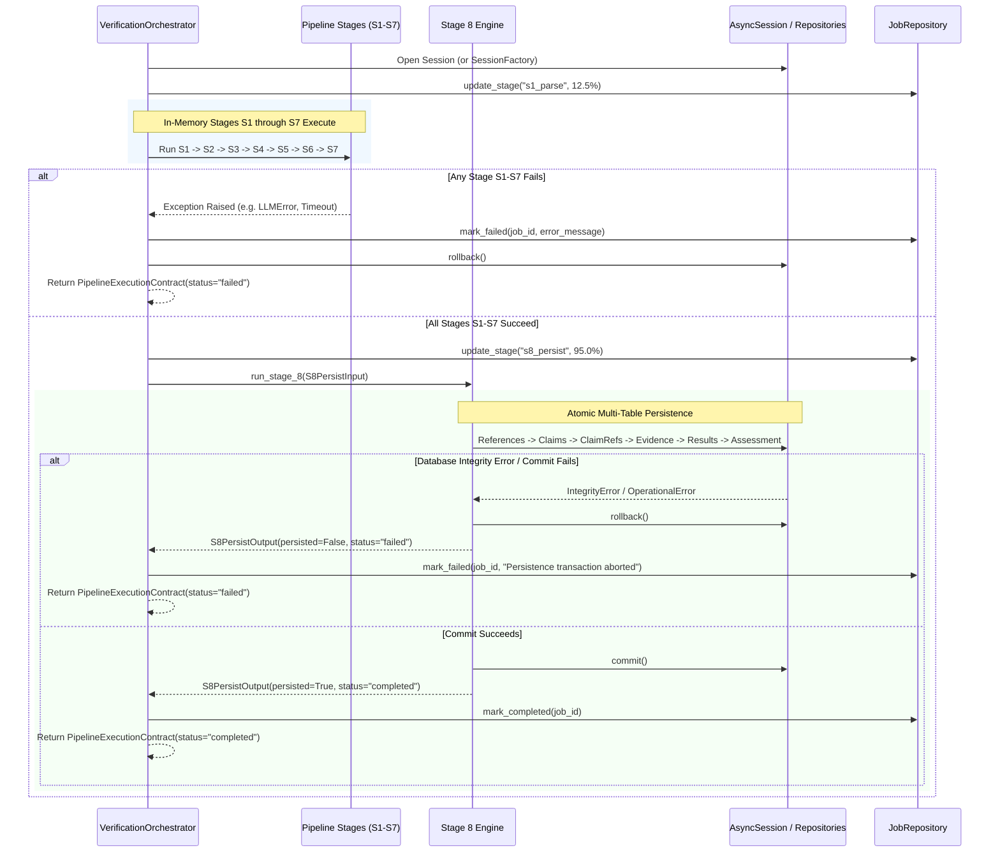

# CiteVerify Stage 8 (S8) — Orchestrator Integration Architecture Audit

**Author:** Aviral (Integration Lead)  
**Date:** November 19, 2026  
**Repository:** `D:\Games\CiteVerify`  
**Target Baseline Branch:** `integration/full-pipeline`  
**Baseline Commit:** `27651365e565af04210750a8277ce454f7c2b820`  
**Current Working Branch:** `feat/s8-orchestrator-integration-aviral`  
**Reference Persistence Foundation:** `feat/s8-database-persistence-ayushnath` (Commit `2e20c93`)  
**Audit Classification:** STRICTLY READ-ONLY ARCHITECTURAL AUDIT  

---

## Executive Summary

CiteVerify has successfully merged Stages S1 through S7, establishing a verified 192-test passing baseline with complete bibliographic resolution (Crossref, OpenAlex, Europe PMC XML), deterministic claim extraction, BM25-based evidence retrieval, claim-level evidence isolation, and transparent citation health assessment.

However, the pipeline orchestrator ([app/pipeline/orchestrator.py](file:///d:/Games/CiteVerify/app/pipeline/orchestrator.py)) currently stops in memory:
1. Stage 8 ([app/stages/s8_persist/__init__.py](file:///d:/Games/CiteVerify/app/stages/s8_persist/__init__.py)) is merely a 36-line skeleton returning a synthetic `persisted=True`.
2. The orchestrator discards intermediate outputs from S1, S2, S3, S4, S5, and S6, passing only `document_id` and `s7_out.model_dump()` to S8.
3. Job progress is tracked exclusively in an in-memory dictionary (`JobRegistry`), leaving the relational `jobs` database table unpopulated.
4. Ayushnath has completed the persistence foundation in `feat/s8-database-persistence-ayushnath` (commit `2e20c93`), providing 10 robust async repository classes and database schema hardening.

This document defines the exact contract, data flow, failure recovery, repository bindings, and test plan required to integrate S8 persistence into the orchestrator.

---

## 1. Exact Current Architecture of `orchestrator.py`

### 1.1 Orchestrator Control Flow
The orchestrator entry point is `VerificationOrchestrator.execute(document_id: str, job_id: str, file_path: str = "") -> PipelineExecutionContract`:

```
[Start execute()]
       │
       ▼
[Update Stage: s1_parse (12.5%)]
  s1_out = await run_stage_1(S1ParseInput(document_id, file_path))
       │
       ▼
[Update Stage: s2_references (25.0%)]
  s2_out = await run_stage_2(S2ReferencesInput(document_id, s1_out.raw_text, s1_out.sections))
       │
       ▼
[Update Stage: s3_claims (37.5%)]
  s3_out = await run_stage_3(S3ClaimsInput(document_id, s1_out.sections, [r.model_dump() for r in s2_out.references]))
       │
       ▼
[Update Stage: s4_resolve (50.0%)]
  s4_out = await run_stage_4(S4ResolveInput(document_id, [r.model_dump() for r in s2_out.references]))
       │
       ▼
[Update Stage: s5_evidence (62.5%)]
  s5_out = await run_stage_5(S5EvidenceInput(document_id, [r.model_dump() for r in s4_out.resolved_references], [c.model_dump() for c in s3_out.claims]))
       │
       ▼
[Enrich Claims with S4 Metadata & Update Stage: s6_verify (75.0%)]
  Map S4 resolved references by citation_key or id
  Inject reference_doi, reference_year, reference_title, is_retracted, retraction_notice, doi_title_mismatch, reference_pmcid
  s6_out = await run_stage_6(S6VerifyInput(document_id, enriched_claims, evidences=[e.model_dump() for e in s5_out.evidence_items], resolved_references=[r.model_dump() for r in s4_out.resolved_references]))
       │
       ▼
[Update Stage: s7_assessment (87.5%)]
  s7_out = await run_stage_7(S7AssessmentInput(document_id, results=[r.model_dump() for r in s6_out.results], claims=enriched_claims, resolved_references=[r.model_dump() for r in s4_out.resolved_references]))
       │
       ▼
[Update Stage: s8_persist (100.0%)]
  s8_out = await run_stage_8(S8PersistInput(document_id=document_id, assessment_data=s7_out.model_dump()))
       │
       ▼
[Mark In-Memory Job Completed (100.0%)]
  job_registry.mark_completed(job_id)
  return PipelineExecutionContract(status="completed", ...)
```

### 1.2 Current Stage Invocation Disconnects
- **S8 Payload Truncation:** Line 170 of `orchestrator.py` passes *only*:
  ```python
  s8_out = await run_stage_8(S8PersistInput(
      document_id=document_id,
      assessment_data=s7_out.model_dump()
  ))
  ```
  `s1_out`, `s2_out`, `s3_out`, `s4_out`, `s5_out`, and `s6_out` are discarded from scope. S8 receives zero references, zero claims, zero evidence passages, and zero verification results.
- **Premature Progress Updates:** `job_registry.update_stage(job_id, "s8_persist", 100.0)` sets progress to 100% *before* S8 actually executes or commits to disk.
- **In-Memory Job Registry Isolation:** `job_registry` operates strictly on an in-memory dictionary `self._jobs: Dict[str, JobRecord]`. The database table `jobs` is never updated.
- **Exception Masking:** When an unhandled exception occurs in any stage, `orchestrator.py` catches `Exception`, updates `job_registry.mark_failed`, and returns `PipelineExecutionContract(status="failed", summary={"error": str(exc)})`. No database rollback is triggered, leaving partial states uncleaned.

---

## 2. Actual Stage Output Types Across S1–S7

Below are the exact Pydantic v2 classes, module locations, and critical attributes returned by Stages S1 through S7:

### Stage 1: Document Parsing (`app.stages.s1_parse.models.S1ParseOutput`)
- **Model:** `S1ParseOutput`
- **Key Attributes:**
  - `document_id: str`
  - `title: str` (defaults to `"Untitled Document"`)
  - `sections: Dict[str, str]` (raw section heading $\rightarrow$ body text)
  - `raw_text: str` (complete normalized document text)
  - `page_count: int`
  - `metadata: DocumentMetadata` (`file_type`, `file_size_bytes`, `authors`, `creator`)
  - `pages: List[PageContent]` (page-level text, char counts, word counts)
  - `structured_sections: List[DocumentSection]` (`heading`, `normalized_heading`, `section_type`, `content`, `order`)
  - `is_scanned: bool`
  - `warnings: List[str]`

### Stage 2: Reference Extraction (`app.stages.s2_references.models.S2ReferencesOutput`)
- **Model:** `S2ReferencesOutput`
- **Key Attributes:**
  - `document_id: str`
  - `references: List[RawReferenceItem]` (legacy backward-compatible references)
  - `structured_references: List[ExtractedReferenceItem]` (`reference_id`, `citation_key`, `raw_citation`, `title`, `authors`, `year`, `journal_or_venue`, `doi`, `arxiv_id`, `url`)
  - `in_text_citations: List[InTextCitationMarker]` (`raw_citation`, `style`, `keys`, `author`, `year`, `sentence`, `section_name`, `page_number`)
  - `hygiene_report: HygieneCheckReport` (`duplicate_dois`, `missing_dois`, `malformed_entries`)
  - `total_references: int`

### Stage 3: Claim Extraction (`app.stages.s3_claims.models.S3ClaimsOutput`)
- **Model:** `S3ClaimsOutput`
- **Key Attributes:**
  - `document_id: str`
  - `claims: List[S3ClaimItem]`
    - `id: str` (stable claim UUID)
    - `document_id: str`
    - `reference_id: Optional[str]`
    - `all_reference_ids: List[str]` (multi-reference support)
    - `citation_key: Optional[str]`
    - `all_citation_keys: List[str]`
    - `claim_text: str`
    - `original_sentence: str`
    - `context_sentence: Optional[str]`
    - `section_name: Optional[str]`
    - `page_number: Optional[int]`
    - `sentence_index: int`
    - `category: ClaimCategoryEnum`
    - `numerical_values: List[str]`
    - `entities: List[str]`
    - `qualifiers: List[str]`
    - `experimental_conditions: Optional[str]`
    - `importance_score: float`
    - `extraction_method: str`
    - `is_active: bool`
  - `total_candidates: int`
  - `selected_claims_count: int`

### Stage 4: Reference Resolution (`app.stages.s4_resolve.models.S4ResolveOutput`)
- **Model:** `S4ResolveOutput`
- **Key Attributes:**
  - `document_id: str`
  - `resolved_references: List[S4ResolvedReference]`
    - `id: str` (stable identifier)
    - `citation_key: str`
    - `reference_id: Optional[str]`
    - `title: str` (canonical Crossref/OpenAlex/EPMC title)
    - `original_title: Optional[str]` (provided bibliography title)
    - `doi: Optional[str]`
    - `pmcid: Optional[str]`
    - `authors: Optional[str]`
    - `year: Optional[int]`
    - `venue: Optional[str]`
    - `url: Optional[str]`
    - `abstract: Optional[str]`
    - `full_text: Optional[str]` (normalized XML text from Europe PMC)
    - `oa_pdf_url: Optional[str]`
    - `is_open_access: bool`
    - `availability_state: str` (`"full_text"`, `"abstract_only"`, `"unavailable"`)
    - `doi_title_mismatch: bool` (Crossref registered title divergence flag)
    - `title_similarity: Optional[float]`
    - `is_retracted: bool`
    - `retraction_notice: Optional[str]`
    - `confidence: float`
    - `source: ResolutionSourceEnum`
    - `status: ResolutionStatusEnum`
  - `total_resolved: int`
  - `total_unresolved: int`

### Stage 5: Evidence Retrieval (`app.stages.s5_evidence.models.S5EvidenceOutput`)
- **Model:** `S5EvidenceOutput`
- **Key Attributes:**
  - `document_id: str`
  - `evidence_items: List[EvidencePassageItem]`
    - `evidence_id: str` (stable passage UUID)
    - `citation_key: str`
    - `reference_id: Optional[str]`
    - `claim_id: Optional[str]` (strict claim ownership)
    - `evidence_text: str`
    - `section_title: Optional[str]`
    - `page_number: Optional[int]`
    - `source_type: EvidenceAvailabilityEnum`
    - `retrieval_score: float`
    - `source_url: Optional[str]`
  - `total_retrieved: int`
  - `full_text_count: int`
  - `abstract_count: int`
  - `unavailable_count: int`

### Stage 6: Claim Verification (`app.stages.s6_verify.models.S6VerifyOutput`)
- **Model:** `S6VerifyOutput`
- **Key Attributes:**
  - `document_id: str`
  - `results: List[VerificationResultItem]`
    - `id: str` (stable result UUID)
    - `claim_id: str`
    - `evidence_id: Optional[str]`
    - `reference_id: Optional[str]`
    - `citation_key: Optional[str]`
    - `verdict: VerdictEnum` (`supported`, `partially_supported`, `unsupported`, `contradictory`, `potentially_outdated`, `insufficient_evidence`)
    - `verdict_strength: float` [0.0, 1.0]
    - `retrieval_match: float` [0.0, 1.0]
    - `evidence_completeness: EvidenceAvailabilityEnum`
    - `explanation: str`
    - `quote_verified: bool`
    - `numerical_consistency: str` (`exact_match`, `mismatch`, `missing_in_source`, `not_applicable`)
    - `numerical_details: Optional[str]`
    - `scope_audit: str` (`consistent`, `overgeneralized`, `hedged`, `context_mismatch`)
    - `scope_details: Optional[str]`
    - `is_retracted_source: bool`
    - `retraction_warning: Optional[str]`
    - `contradiction_type: Optional[str]`
    - `needs_human_review: bool`
    - `model_name: str`
    - `verification_method: str`
  - `total_verified: int`

### Stage 7: Assessment (`app.stages.s7_assessment.models.S7AssessmentOutput`)
- **Model:** `S7AssessmentOutput`
- **Key Attributes:**
  - `document_id: str`
  - `overall_health_score: float` [0.0, 100.0]
  - `summary: Dict[str, int]` (counts per verdict)
  - `assessment_notes: str`
  - `report: Optional[DocumentAssessmentReport]`
    - `assessment_verdict: AssessmentVerdictEnum`
    - `overall_health_score: float`
    - `confidence_score: float` [0.0, 1.0]
    - `verdicts_summary: Dict[str, VerdictStats]`
    - `evidence_completeness: EvidenceCompletenessStats`
    - `discrepancies: DiscrepancyStats`
    - `high_priority_reviews: List[HumanReviewItem]`
    - `factors: List[AssessmentFactorItem]`
    - `executive_summary: str`
    - `methodology_notes: str`
    - `limitations_disclaimer: str`

---

## 3. Exact Repository Interfaces from Ayushnath's Branch (`2e20c93`)

Ayushnath has implemented 10 dedicated async repositories in `app/repositories/`. Every repository inherits from `BaseRepository[ModelType]` and expects an active SQLAlchemy `AsyncSession`:

### 3.1 `DocumentRepository` ([app/repositories/documents.py](file:///d:/Games/CiteVerify/app/repositories/documents.py))
- `__init__(session: AsyncSession)`
- `async create(title: str, doi: Optional[str] = None, authors: Optional[str] = None, file_path: Optional[str] = None, file_hash: Optional[str] = None, file_type: Optional[str] = None, file_size_bytes: int = 0, page_count: int = 1, status: str = "pending", document_id: Optional[str] = None) -> Document`
- `async update_status(document_id: str, status: str) -> Optional[Document]`
- `async get_with_relations(document_id: str) -> Optional[Document]` (eagerly loads `references`, `claims`, `assessment`, `jobs`)
- `async list_documents(skip: int = 0, limit: int = 50) -> List[Document]`

### 3.2 `JobRepository` ([app/repositories/jobs.py](file:///d:/Games/CiteVerify/app/repositories/jobs.py))
- `__init__(session: AsyncSession)`
- `async create_job(document_id: str, job_id: Optional[str] = None, stage: str = "s1_parse", status: str = "pending", progress: float = 0.0) -> Job`
- `async update_stage(job_id: str, stage: str, progress: float) -> Optional[Job]`
- `async mark_completed(job_id: str) -> Optional[Job]`
- `async mark_failed(job_id: str, error_message: str) -> Optional[Job]`
- `async get_by_document(document_id: str) -> List[Job]`
- `async get_active_jobs() -> List[Job]`

### 3.3 `ReferenceRepository` ([app/repositories/references.py](file:///d:/Games/CiteVerify/app/repositories/references.py))
- `__init__(session: AsyncSession)`
- `async create(document_id: str, raw_citation: str, reference_id: Optional[str] = None, citation_key: Optional[str] = None, resolved_title: Optional[str] = None, resolved_doi: Optional[str] = None, resolved_year: Optional[int] = None, resolved_venue: Optional[str] = None, resolution_confidence: float = 0.0, authors: Optional[str] = None, pmcid: Optional[str] = None, url: Optional[str] = None, oa_pdf_url: Optional[str] = None, is_open_access: bool = False, availability_state: str = "unavailable", is_retracted: bool = False, retraction_notice: Optional[str] = None, resolution_source: Optional[str] = None, resolution_status: str = "unresolved", doi_title_mismatch: bool = False) -> Reference`
- `async bulk_create(references_data: List[Dict[str, Any]]) -> List[Reference]`
- `async get_by_document(document_id: str) -> List[Reference]`
- `async get_by_citation_key(document_id: str, citation_key: str) -> Optional[Reference]`
- `async get_by_doi(document_id: str, doi: str) -> Optional[Reference]`

### 3.4 `ClaimRepository` ([app/repositories/claims.py](file:///d:/Games/CiteVerify/app/repositories/claims.py))
- `__init__(session: AsyncSession)`
- `async create(document_id: str, claim_text: str, claim_id: Optional[str] = None, reference_id: Optional[str] = None, context_sentence: Optional[str] = None, section_name: Optional[str] = None, page_number: Optional[int] = None, is_active: bool = True, category: str = "other", citation_key: Optional[str] = None, original_sentence: Optional[str] = None, sentence_index: int = 0, is_key_claim: bool = True, numerical_values: Optional[List[str]] = None, entities: Optional[List[str]] = None, qualifiers: Optional[List[str]] = None, experimental_conditions: Optional[str] = None, importance_score: float = 0.0, extraction_method: str = "deterministic_rule_based") -> Claim`
- `async link_reference(claim_id: str, reference_id: str, citation_key: Optional[str] = None) -> ClaimReference`
- `async link_multiple_references(claim_id: str, reference_ids: List[str], citation_key: Optional[str] = None) -> List[ClaimReference]`
- `async get_with_associations(claim_id: str) -> Optional[Claim]`
- `async get_by_document(document_id: str, active_only: bool = False) -> List[Claim]`
- `async toggle_active(claim_id: str, is_active: bool) -> Optional[Claim]`

### 3.5 `EvidenceRepository` ([app/repositories/evidence.py](file:///d:/Games/CiteVerify/app/repositories/evidence.py))
- `__init__(session: AsyncSession)`
- `async create(reference_id: str, evidence_text: str, evidence_id: Optional[str] = None, claim_id: Optional[str] = None, section_title: Optional[str] = None, page_number: Optional[int] = None, source_type: str = "full_text_available", retrieval_score: float = 0.0, source_url: Optional[str] = None) -> Evidence`
- `async bulk_create(evidence_data: List[Dict[str, Any]]) -> List[Evidence]`
- `async get_by_reference(reference_id: str) -> List[Evidence]`
- `async get_by_claim(claim_id: str) -> List[Evidence]`

### 3.6 `ResultRepository` ([app/repositories/results.py](file:///d:/Games/CiteVerify/app/repositories/results.py))
- `__init__(session: AsyncSession)`
- `async create(claim_id: str, verdict: str, result_id: Optional[str] = None, evidence_id: Optional[str] = None, reference_id: Optional[str] = None, verdict_strength: float = 0.0, retrieval_match: float = 0.0, evidence_completeness: str = "unavailable", explanation: Optional[str] = None, quote_verified: bool = False, numerical_consistency: str = "not_applicable", numerical_details: Optional[str] = None, scope_audit: str = "consistent", scope_details: Optional[str] = None, is_retracted_source: bool = False, retraction_warning: Optional[str] = None, contradiction_type: Optional[str] = None, needs_human_review: bool = False, model_name: Optional[str] = None, verification_method: str = "llm_nli", warnings: Optional[List[str]] = None) -> Result`
- `async bulk_create(results_data: List[Dict[str, Any]]) -> List[Result]`
- `async get_with_reviews(result_id: str) -> Optional[Result]`
- `async get_by_document(document_id: str) -> List[Result]`

### 3.7 `AssessmentRepository` ([app/repositories/assessments.py](file:///d:/Games/CiteVerify/app/repositories/assessments.py))
- `__init__(session: AsyncSession)`
- `async save_assessment(document_id: str, overall_health_score: float, assessment_verdict: str, confidence_score: float = 0.0, verdicts_summary: Optional[Dict[str, Any]] = None, evidence_completeness: Optional[Dict[str, Any]] = None, discrepancies: Optional[Dict[str, Any]] = None, factors: Optional[List[Dict[str, Any]]] = None, high_priority_reviews: Optional[List[Dict[str, Any]]] = None, executive_summary: Optional[str] = None, methodology_notes: Optional[str] = None, limitations_disclaimer: Optional[str] = None) -> Assessment` (upserts based on unique `document_id`)
- `async get_by_document(document_id: str) -> Optional[Assessment]`

### 3.8 `AuditLogRepository` ([app/repositories/audit.py](file:///d:/Games/CiteVerify/app/repositories/audit.py))
- `__init__(session: AsyncSession)`
- `async log(action: str, actor: str = "system", document_id: Optional[str] = None, details: Optional[Union[str, Dict[str, Any]]] = None) -> AuditLog`
- `async get_by_document(document_id: str) -> List[AuditLog]`

---

## 4. Proposed S8 Integration Contract

To avoid breaking existing unit tests while supplying full artifact persistence, the new S8 persistence input model in `app/stages/s8_persist/models.py` must support **both** structured stage objects and legacy dictionary inputs.

### 4.1 Proposed `S8PersistInput` Contract
```python
from typing import Any, Dict, List, Optional
from pydantic import BaseModel, ConfigDict, Field
from sqlalchemy.ext.asyncio import AsyncSession

from app.stages.s1_parse.models import S1ParseOutput
from app.stages.s2_references.models import S2ReferencesOutput
from app.stages.s3_claims.models import S3ClaimsOutput
from app.stages.s4_resolve.models import S4ResolveOutput
from app.stages.s5_evidence.models import S5EvidenceOutput
from app.stages.s6_verify.models import S6VerifyOutput
from app.stages.s7_assessment.models import S7AssessmentOutput


class S8PersistInput(BaseModel):
    """Complete, typed input contract for Stage 8 persistence.
    
    Backward-compatible: 'assessment_data' remains supported for existing test fixtures.
    """
    model_config = ConfigDict(arbitrary_types_allowed=True)

    document_id: str = Field(..., description="Target document UUID")
    job_id: Optional[str] = Field(None, description="Optional job UUID for tracking")

    # Full stage outputs
    s1_parse: Optional[S1ParseOutput] = None
    s2_references: Optional[S2ReferencesOutput] = None
    s3_claims: Optional[S3ClaimsOutput] = None
    s4_resolve: Optional[S4ResolveOutput] = None
    s5_evidence: Optional[S5EvidenceOutput] = None
    s6_verify: Optional[S6VerifyOutput] = None
    s7_assessment: Optional[S7AssessmentOutput] = None

    # Legacy compatibility field (allows existing tests to pass without modification)
    assessment_data: Optional[Dict[str, Any]] = None

    # Optional dependency injection for sessions (critical for transactional in-memory testing)
    session: Optional[AsyncSession] = None
```

### 4.2 Proposed `S8PersistOutput` Contract
```python
class S8PersistOutput(BaseModel):
    """Output contract confirming database persistence status and metrics."""
    document_id: str
    job_id: Optional[str] = None
    persisted: bool = False
    status: str = "completed"
    
    # Audit counts of records inserted/upserted
    references_persisted: int = 0
    claims_persisted: int = 0
    claim_references_linked: int = 0
    evidence_persisted: int = 0
    results_persisted: int = 0
    assessment_persisted: bool = False
    
    warnings: List[str] = Field(default_factory=list)
```

---

## 5. Job and Progress Integration Architecture

To bridge the gap between `orchestrator.py` and the database, the orchestrator must synchronize both the in-memory `job_registry` and Ayushnath's `JobRepository`.

### 5.1 Dual-Track Progress Synchronization
```
 Stage Started  ──► [job_registry.update_stage(job_id, stage, progress)]  (In-Memory Fast Track)
        │
        └────────► [job_repo.update_stage(job_id, stage, progress)]       (Database Persistent Track)
```

### 5.2 Precise Stage Progress Mapping
| Stage | Stage ID | Target Progress | Database Entity Staged |
|:---|:---|:---:|:---|
| Ingestion | `pending` | 0.0% | `Document`, `Job` created |
| S1: Parse | `s1_parse` | 12.5% | Parse metadata, page counts |
| S2: References | `s2_references` | 25.0% | Bibliographic entries extracted |
| S3: Claims | `s3_claims` | 37.5% | Claims extracted |
| S4: Resolve | `s4_resolve` | 50.0% | DOI matched, Crossref/OpenAlex/EPMC resolved |
| S5: Evidence | `s5_evidence` | 62.5% | BM25 passages retrieved |
| S6: Verify | `s6_verify` | 75.0% | Automated verdicts computed |
| S7: Assessment | `s7_assessment` | 87.5% | Health metrics and summary generated |
| S8: Persist | `s8_persist` | 95.0% | Database transaction underway |
| **Completed** | `completed` | **100.0%** | **Committed to DB; Job marked completed** |

> [!IMPORTANT]
> The progress must **only** transition to 100.0% and status `"completed"` **after** S8 completes its database transaction and executes `session.commit()`. If S8 fails, the job remains at 95.0% and transitions to `"failed"`.

---

## 6. Failure and Transaction Handling Strategy



### 6.1 Transaction Isolation Rules:
1. **Single Atomic Flush/Commit for S8:** S8 must persist all entities (`Reference`, `Claim`, `ClaimReference`, `Evidence`, `Result`, `Assessment`) within a **single async transaction**. If any entity violates a foreign key or data constraint, `session.rollback()` is invoked so no partial or orphaned data remains.
2. **Dedicated Error Session for Job Failure:** If the main transaction rolls back, updating the `Job` to `"failed"` must occur in a clean session so that the job error itself is guaranteed to be saved.
3. **SQLite WAL Mode Protection:** As implemented in Ayushnath's `app/core/db.py`, SQLite busy timeout (30,000ms) and WAL mode ensure that background pipeline commits do not clash with concurrent web requests.

---

## 7. File-Level Implementation Plan

When implementation begins, work will be partitioned cleanly across the following files without disturbing existing stage logic:

```
app/
├── pipeline/
│   └── orchestrator.py             [UPDATE] Pass full S1-S7 outputs to S8; bind JobRepository updates
├── stages/
│   └── s8_persist/
│       ├── __init__.py             [UPDATE] Export new models and run_stage_8 entrypoint
│       ├── models.py               [NEW] Typed S8PersistInput and S8PersistOutput
│       └── persistence_engine.py   [NEW] Async persistence implementation using Ayushnath's repositories
```

### Implementation Specifics for `orchestrator.py`:
1. **Forward Intermediate Stage Objects:**
   Modify the active call in `VerificationOrchestrator.execute()`:
   ```python
   # Stage 8: Persistence
   job_registry.update_stage(job_id, "s8_persist", 95.0)
   s8_input = S8PersistInput(
       document_id=document_id,
       job_id=job_id,
       s1_parse=s1_out,
       s2_references=s2_out,
       s3_claims=s3_out,
       s4_resolve=s4_out,
       s5_evidence=s5_out,
       s6_verify=s6_out,
       s7_assessment=s7_out,
       assessment_data=s7_out.model_dump(),
   )
   s8_out = await run_stage_8(s8_input)
   ```
2. **Condition Completion on `s8_out.persisted`:**
   ```python
   if not s8_out.persisted:
       raise PersistenceError(f"Stage 8 failed to persist document {document_id}")
   
   job_registry.mark_completed(job_id)
   ```

---

## 8. Test Plan

To prove orchestrator integration before merging into `integration/full-pipeline`, the following test suite must be implemented in `tests/test_s8_orchestrator_integration.py`:

| Test Name | Verification Target |
|:---|:---|
| `test_orchestrator_forwards_complete_stage_payload_to_s8` | Verify S8 receives non-null instances of `s1_parse`, `s2_references`, `s3_claims`, `s4_resolve`, `s5_evidence`, `s6_verify`, `s7_assessment`. |
| `test_orchestrator_persists_full_document_graph_to_database` | Verify that after `orchestrator.execute()`, querying `DocumentRepository`, `ReferenceRepository`, `ClaimRepository`, `EvidenceRepository`, `ResultRepository`, and `AssessmentRepository` returns all expected entities. |
| `test_orchestrator_claim_reference_m2m_linkage` | Verify that claims with multiple citation keys are correctly linked via `ClaimReference` in the database. |
| `test_orchestrator_aborts_and_marks_failed_when_s8_persistence_fails` | Inject a mock persistence failure into `run_stage_8`; verify job status is `"failed"` and no orphaned records exist. |
| `test_orchestrator_progress_reaches_100_only_after_s8_commit` | Monitor progress stages; prove progress is 95% during S8 and transitions to 100% only after successful commit. |
| `test_orchestrator_backward_compatibility_with_existing_e2e_tests` | Run existing `tests/test_end_to_end.py` and `tests/test_api.py` to guarantee zero regressions. |

---

## 9. Risks and Unresolved Dependencies

1. **Dependency on Merging Ayushnath's Database Foundation:**  
   - *Risk:* Ayushnath's `feat/s8-database-persistence-ayushnath` (commit `2e20c93`) contains the database schema updates, migrations, and `app/repositories/` package.
   - *Status:* Ayushnath's branch is fully completed, tested (10 tests passing), and pushed to remote.
   - *Action Required:* Ayushnath's branch must be merged into `integration/full-pipeline` before the orchestrator can import `app.repositories.*`.
2. **Ayushman's S8 Persistence Engine Scope:**  
   - *Question:* Is Ayushman implementing the internal logic of `app/stages/s8_persist/` (e.g. `persistence_engine.py`), or should Aviral implement it as part of orchestrator integration?
   - *Resolution:* If Ayushman is implementing the internal persistence engine in `feat/s8-persistence-testing-ayushman`, Aviral's orchestrator implementation will wire `run_stage_8` to consume Ayushman's engine. If Ayushman is focusing solely on evaluation testing, Aviral can implement the engine using Ayushnath's repositories directly.
3. **Session Management in Background Tasks vs In-Memory Tests:**  
   - *Risk:* In production, background tasks must create their own session from `AsyncSessionLocal`. In tests, an in-memory SQLite session is injected.
   - *Mitigation:* `S8PersistInput` allows an optional `session: Optional[AsyncSession] = None`. When `None`, `run_stage_8` opens its own session from `AsyncSessionLocal()`.

---

## 10. Architectural Recommendation

### Can Orchestrator Implementation Begin Now?

> **Recommendation: YES, with a two-phase staging strategy.**

1. **Phase 1 (Immediate — Unblocked):**  
   - We can define the typed contract `S8PersistInput` in `app/stages/s8_persist/models.py` and update `app/pipeline/orchestrator.py` to collect and pass all intermediate stage outputs (`s1_out`, `s2_out`, `s3_out`, `s4_out`, `s5_out`, `s6_out`, `s7_out`) to S8.
   - We can keep `run_stage_8` backward-compatible so that all existing 192 backend tests continue to pass without a database dependency.
2. **Phase 2 (Blocked on Merge of `feat/s8-database-persistence-ayushnath`):**  
   - Connecting `run_stage_8` to real database writes requires the `app/repositories/` module from Ayushnath's branch `2e20c93`.
   - Once Ayushnath's branch is merged into `integration/full-pipeline`, `run_stage_8` can instantiate Ayushnath's repositories and execute atomic commits.

---

*Report filed on branch `feat/s8-orchestrator-integration-aviral` at HEAD `2765136`.*

