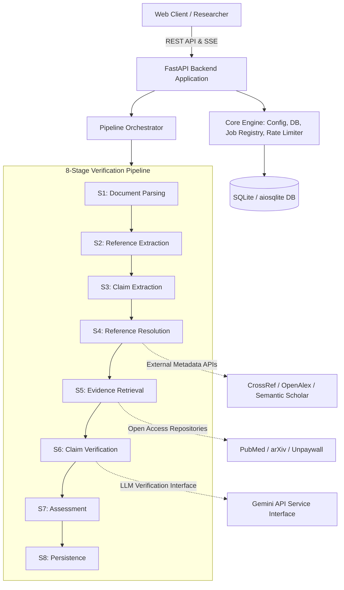

# CiteVerify System Architecture

CiteVerify is designed as an evidence-linked scientific claim verification engine. It isolates each step of document ingestion, citation extraction, external retrieval, semantic verification, and human audit to ensure scientific reproducibility and transparency.

## High-Level System Architecture

## Modular Components

1. **API Layer (`app/api/`)**:
   - `documents.py`: Document ingestion, demo bootstrapping, status, and metadata access.
   - `events.py`: Real-time SSE streaming of pipeline execution logs and job status changes.
   - `reviews.py`: Human-in-the-loop dispute, confirmation, and review overrides.
   - `export.py`: Structured data exports (JSON, CSV, Markdown, BibTeX).
   - `audit.py`: Complete audit log query interface for compliance and verification traceability.

2. **Core Layer (`app/core/`)**:
   - `db.py`: Async SQLAlchemy 2.0 engine, declarative base, and session generators.
   - `http.py`: Shared, lifecycle-managed `httpx.AsyncClient` with standard retry/backoff policies.
   - `llm.py`: Isolated LLM service abstraction interface (Gemini API) keeping provider logic decoupled from pipeline reasoning.
   - `limiters.py`: Token bucket rate limiting protecting external academic APIs from throttling.
   - `jobs.py`: In-memory async job queue tracking lifecycle states (`pending`, `running`, `completed`, `failed`).
   - `exceptions.py`: Domain-specific exceptions mapped to standardized JSON HTTP responses.

3. **Data Model Layer (`app/models/`)**:
   - `tables.py`: Normalized SQLAlchemy 2.0 relational models.
   - `schemas.py`: Pydantic v2 schemas enforcing strict validation and contract serialization.

4. **8-Stage Pipeline (`app/stages/`)**:
   - Discrete, typed stages ensuring single responsibility and independent testability.

