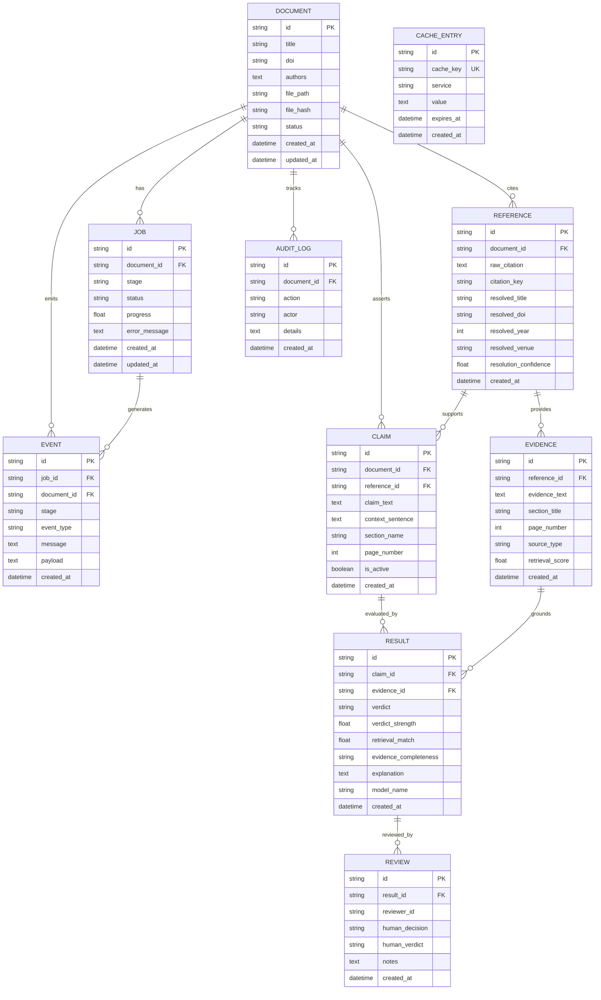

# CiteVerify Database Schema Specification

CiteVerify uses SQLite with `aiosqlite` and SQLAlchemy 2.x async ORM.

## Schema ER Diagram

## Relational Design Highlights

1. **Separation of Concerns:**
   - `verdict` represents automated LLM classification.
   - `reviews` represents human judgment without altering raw algorithm output.
   - `evidence_completeness` distinguishes whether full-text or merely abstract was used.
   - `retrieval_match` captures lexical/semantic similarity distinct from logical entailment (`verdict_strength`).
2. **Cascades:**
   - Deleting a `Document` cascades to delete associated `Job`, `Event`, `Reference`, `Claim`, and `AuditLog` rows.
3. **Indexing:**
   - UUID primary keys for distributed identification.
   - Indexes on foreign keys and frequently queried status/doi columns.

