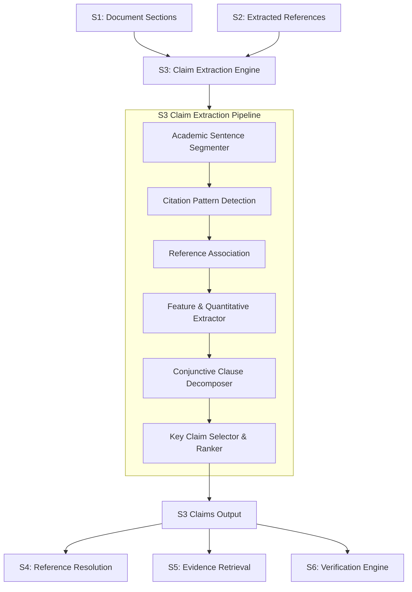

# S3: Scientific Claim Extraction Specification

## 1. Overview & Architecture

**Stage 3 (S3)** is the central extraction engine of the CiteVerify verification pipeline. Its mission is to parse segmented manuscript sections, detect citations (numeric, author-year, and ranges), extract verifiable scientific claims, extract quantitative parameters/entities/conditions, and rank the top 5–12 claims for downstream verification.

---

## 2. Input and Output Contracts

### Input Schema (`S3ClaimsInput`)
- `document_id: str`: Unique document identifier.
- `sections: Dict[str, Any]`: Dictionary mapping section headers (`Abstract`, `Introduction`, `Methods`, `Results`, `Discussion`) to raw text.
- `references: Optional[List[dict]]`: Upstream extracted bibliography items from Stage 2 (`citation_key`, `raw_citation`, `id`).
- `max_key_claims: int`: Target threshold of key claims to select (defaults to 12).

### Output Schema (`S3ClaimsOutput`)
- `document_id: str`: Traceable manuscript ID.
- `total_candidates: int`: Total verifiable claim assertions identified.
- `selected_claims_count: int`: Number of prioritized key claims selected for verification.
- `uncited_claims_count: int`: Number of empirical claims lacking explicit in-text citations.
- `claims: List[S3ClaimItem]`: List of structured claims.
- `warnings: List[str]`: Pipeline extraction warnings.

### Claim Item Model (`S3ClaimItem`)
- `id: str`: Stable UUID string.
- `document_id: str`: Foreign key to `documents.id`.
- `reference_id: Optional[str]`: Foreign key to `references.id` if matched.
- `citation_key: Optional[str]`: Primary citation marker (e.g. `[1]`, `(Smith et al., 2023)`).
- `all_citation_keys: List[str]`: All detected citation markers in sentence.
- `claim_text: str`: Normalized assertion text.
- `original_sentence: str`: Complete unmodified sentence.
- `context_sentence: Optional[str]`: Surrounding or compound context.
- `section_name: Optional[str]`: Source section header.
- `page_number: Optional[int]`: Page coordinate if available.
- `category: ClaimCategoryEnum`: One of `empirical`, `statistical`, `comparative`, `causal`, `methodological`, `literature`, `quantitative`, or `other`.
- `is_cited: bool`: True if associated with an in-text citation marker.
- `is_key_claim: bool`: Flag identifying prioritized claims.
- `numerical_values: List[str]`: Extracted numerical values with units (e.g. `['41.5%', '2.5-fold']`).
- `entities: List[str]`: Named scientific entities and models.
- `experimental_conditions: Optional[str]`: In-vivo/in-vitro conditions or experimental setup.
- `qualifiers: List[str]`: Modal verbs and qualifiers (e.g. `typically`, `partially`).
- `importance_score: float`: Weighted heuristic score.
- `extraction_method: str`: `deterministic_rule_based` or `llm_enhanced`.

---

## 3. Supported Citation Formats

1. **Bracketed Numeric:**
   - Single: `[1]`
   - Comma-delimited: `[1, 2, 3]`
   - Ranges (hyphen and en-dash): `[1-4]`, `[1–4]` (expanded deterministically into `[1]`, `[2]`, `[3]`, `[4]`).
2. **Parenthetical Author-Year:**
   - Single author: `(Smith, 2023)`
   - Multiple authors: `(Smith and Jones, 2022)`
   - Et al.: `(Smith et al., 2023)`
   - Semicolon-separated: `(Smith, 2020; Lee et al., 2021)`
3. **Narrative In-Text:**
   - `Vaswani et al. (2017)`
   - `Smith et al. [1]`

---

## 4. Claim Classification & Feature Extraction

Claims are categorized into 8 standardized types based on academic linguistic triggers:
- **`statistical`**: P-values (`p < 0.01`), confidence intervals (`95% CI`), F1-scores, accuracy, variance.
- **`quantitative`**: Numerical quantities with scientific units (`41.5%`, `2.5-fold`, `18 pages`, `288 K`, `mg/kg`).
- **`comparative`**: Explicit comparative benchmarks (`outperformed`, `superior to`, `faster than`, `improved by`).
- **`causal`**: Direct causal relationships (`leads to`, `induced`, `reduces`, `promotes`, `inhibits`).
- **`methodological`**: Algorithmic or architectural definitions (`we propose`, `we design`, `architecture consists of`).
- **`empirical`**: Experimental observations (`observed`, `demonstrated that`, `revealed`).
- **`literature`**: Citation-linked background assertions.
- **`other`**: General assertions.

### Non-Claim Filtering
Sentences matching non-claim boilerplate patterns (author acknowledgements, copyright notices, grant funding disclosures, conflict of interest declarations) are automatically filtered out.

---

## 5. LLM Integration & Robust Fallback Behavior

- Uses the centralized `app.core.llm.BaseLLMClient` abstraction.
- Formulates structured JSON prompts validated against `LLMClaimExtractionResponse` Pydantic schemas.
- **Bounded Retries**: Maximum 2 retries with exponential backoff.
- **Graceful Deterministic Fallback**: In the event of API timeout, network failure, or malformed JSON, S3 seamlessly falls back to rule-based deterministic extraction without breaking the pipeline or fabricating data.

---

## 6. Test Coverage

The S3 implementation is validated with 27 automated tests:
1. `tests/test_s3_claims.py`: Numeric citations, author-year detection, narrative detection, reference association, sentence segmentation, non-claim filtering, sentence decomposition.
2. `tests/test_s3_edge_cases.py`: En-dash numeric ranges, experimental conditions, qualifiers, uncited claims, LLM timeout handling, malformed JSON fallback, deterministic engine operation.
3. `tests/test_api.py` and `tests/test_end_to_end.py`: Orchestration compatibility.
