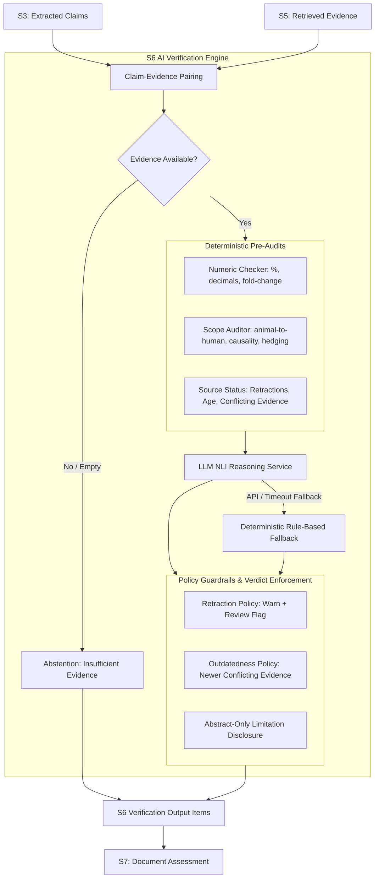

# S6: Scientific Claim Verification Specification

## 1. Overview & Architecture

**Stage 6 (S6)** is the AI Verification Engine of the CiteVerify platform. Its responsibility is to evaluate whether cited scientific evidence passages logically entail, partially substantiate, refute, or fail to support extracted claims.

It combines deterministic analytical auditing (numerical equivalence, unit consistency, scope overgeneralization, and source retraction flags) with deep LLM Natural Language Inference (NLI) reasoning and resilient rule-based fallbacks.

---

## 2. Input and Output Contracts

### Input Schema (`S6VerifyInput`)
- `document_id: str`: Unique document identifier.
- `pairs: Optional[List[ClaimEvidencePair]]`: Pre-structured pairings of claims and evidence passages.
- `claims: Optional[List[dict]]`: Extracted claims from Stage 3.
- `evidences: Optional[List[dict]]`: Retrieved evidence items from Stage 5.
- `claims_with_evidence: Optional[List[dict]]`: Backward-compatible list of evidence items.

### Structured Pair Model (`ClaimEvidencePair`)
Preserves complete scientific provenance and experimental context:
- `claim_id: str`: Foreign reference to extracted claim.
- `claim_text: str`: Normalized assertion text.
- `original_sentence: Optional[str]`: Full sentence context.
- `section_name: Optional[str]`: Section where claim appeared.
- `page_number: Optional[int]`: Page coordinate.
- `numerical_values: List[str]`: Quantitative claims (`['41.5%', '3-fold']`).
- `qualifiers: List[str]`: Epistemic markers (`['preliminary', 'partially']`).
- `experimental_conditions: Optional[str]`: In-vivo/in-vitro conditions or experimental setup.
- `reference_id: Optional[str]`: Primary resolved reference identifier.
- `all_reference_ids: List[str]`: Complete list of resolved reference IDs.
- `citation_key: Optional[str]`: Primary citation key (`[1]`).
- `all_citation_keys: List[str]`: All in-text citation markers.
- `evidence_passages: List[EvidencePassage]`: Retrieved cited passages.
- `reference_doi: Optional[str]`: DOI of cited source.
- `reference_year: Optional[int]`: Publication year.
- `is_retracted: bool`: Flag indicating publisher retraction.
- `retraction_notice: Optional[str]`: Details of retraction.
- `has_newer_conflicting_evidence: bool`: Flag indicating superseding conflicting consensus.
- `newer_conflicting_summary: Optional[str]`: Details of conflicting recent evidence.

### Evidence Passage Model (`EvidencePassage`)
- `evidence_id: str`: Stable passage UUID.
- `citation_key: str`: Linked citation marker.
- `reference_id: Optional[str]`: Resolved reference ID.
- `evidence_text: str`: Verbatim retrieved text snippet.
- `section_title: Optional[str]`: Source section (`Abstract`, `Results`).
- `page_number: Optional[int]`: Source page coordinate.
- `source_type: EvidenceAvailabilityEnum`: `full_text_available`, `abstract_only`, or `unavailable`.
- `retrieval_score: float`: Semantic search relevance score ($0.0 \le s \le 1.0$).
- `source_url: Optional[str]`: Provenance URL or open-access resolver link.

### Output Item Model (`VerificationResultItem`)
Emits orthogonal evaluation dimensions and traceable metadata:
- `id: str`: Unique result UUID.
- `claim_id: str`: ID of evaluated claim.
- `evidence_id: Optional[str]`: ID of primary cited evidence passage.
- `reference_id: Optional[str]`: Primary cited reference ID.
- `all_reference_ids: List[str]`: Complete list of all resolved references.
- `citation_key: Optional[str]`: In-text citation key.
- **Core Orthogonal Dimensions:**
  - `verdict`: Standardized verdict enum.
  - `verdict_strength: float`: Confidence in automated logical entailment ($0.0$ to $1.0$).
  - `retrieval_match: float`: Content similarity between claim and evidence passage ($0.0$ to $1.0$).
  - `evidence_completeness`: `full_text_available`, `abstract_only`, or `unavailable`.
- **Analytical Reasoning:**
  - `explanation: str`: Detailed step-by-step scientific justification.
  - `quote_verified: bool`: Flag indicating verbatim phrase verification.
  - `numerical_consistency: str`: `exact_match`, `mismatch`, `missing_in_source`, or `not_applicable`.
  - `numerical_details: Optional[str]`: Specific quantities compared and disparities found.
  - `scope_audit: str`: `consistent`, `overgeneralized`, `hedged`, or `context_mismatch`.
  - `scope_details: Optional[str]`: Overgeneralization details (e.g. animal-to-human, correlation-to-causation).
- **Source Status & Safety:**
  - `is_retracted_source: bool`: True if source paper was retracted.
  - `retraction_warning: Optional[str]`: Retraction advisory notice.
  - `contradiction_type: Optional[str]`: `direct_refutation`, `retracted_source`, `opposite_effect`, or `null`.
  - `needs_human_review: bool`: Flag for mandatory human oversight.
  - `model_name: str`: LLM model evaluated (`gemini-1.5-pro`).
  - `verification_method: str`: `llm_nli`, `deterministic_rule_based`, or `abstention`.
  - `warnings: List[str]`: Explicit limitation and safety advisories.

---

## 3. Standardized Verdict Matrix

| Verdict | Definition | Typical Conditions |
| :--- | :--- | :--- |
| **`supported`** | Cited passage directly and unambiguously entails the claim's core findings and numbers. | High textual/semantic alignment, numerical values match, scope and conditions consistent. |
| **`partially_supported`** | Evidence supports part of the claim, or claim overgeneralizes a specific finding, or minor conditions differ. | Preclinical to human overgeneralization, correlation claimed as causation, or qualitative match with missing quantitative specifics. |
| **`unsupported`** | Cited passage discusses related topics but does not corroborate the stated findings, mechanisms, or numbers. | Low semantic overlap, asserted mechanism unmentioned in cited passage. |
| **`contradictory`** | Cited passage directly refutes the claim or establishes an opposing effect under comparable conditions. | Conflicting numerical measurements (e.g. 75% vs 12%), opposing clinical outcomes, or direct negation. |
| **`potentially_outdated`** | Cited passage has been superseded or challenged by newer conflicting scientific consensus. | Identifiable newer conflicting study or updated clinical guidelines supersede the cited paper. |
| **`insufficient_evidence`** | Cited passage is absent, incomplete, inaccessible, or retracted without counter-evidence. | Retrieval failed, paper behind paywall with no abstract, or retracted paper where findings cannot be independently evaluated. |

---

## 4. Orthogonal Dimension Separation

To avoid conflating retrieval quality with logical entailment:
1. **`verdict_strength` ($0.0 \dots 1.0$):** Measures confidence in logical entailment or refutation.
2. **`retrieval_match` ($0.0 \dots 1.0$):** Measures token and semantic relevance between the query claim and retrieved passage.
3. **`evidence_completeness`:** Distinguishes full-text access from abstract-only or unavailable sources.

A claim may have a high `retrieval_match` (both claim and passage discuss "HER2-targeted trastuzumab therapy") while having a `contradictory` verdict (the passage demonstrates toxicity rather than efficacy).

---

## 5. Deterministic Auditing Modules

### Numerical Consistency Checker (`numeric_checker.py`)
- Normalizes scientific numbers, decimals, ranges, inequalities, and fold changes.
- Automatically equates percentage and decimal representations (e.g. `41.5%` $\equiv$ `0.415`).
- Enforces strict dimensional unit compatibility (`cohort`, `mass`, `volume`, `length`, `time`, `proportion`, `multiplier`, `p_value`), preventing cross-dimensional false matches (e.g. `100 patients` vs `100 mg` is flagged as incompatible).
- Supports range containment (e.g. `10–20%` contains `15%`) and inequality satisfaction (e.g. `p < 0.05` is compatible with `p = 0.01`).
- Equates fractional ratios with percentages (e.g. `15/20` $\equiv$ `75%`).
- Distinguishes fold changes from percentages (e.g. `2-fold` vs `200%` is recognized as incompatible dimensions).
- Flags directional conflicts (e.g. `25% increase` vs `25% reduction`).
- Detects discrepancies and assigns statuses: `exact_match`, `range_containment`, `compatible_inequality`, `mismatch`, `indeterminate`, `missing_in_source`, or `not_applicable`.

### Multi-Passage Joint Evaluation Engine (`engine.py`)
- Evaluates all valid evidence passages associated with a claim without losing section and page boundaries.
- Jointly corroborates experimental conditions (e.g. in Methods) and quantitative findings (e.g. in Results).
- Prevents one supporting passage from masking contradictions in another passage (contradictions across clauses take precedence).
- Excludes passages from unrelated references.
- Preserves full provenance (`evidence_id`, `section_title`, `page_number`) in audit notes without fabricating missing fields.

### Orchestrated Retraction Propagation (`orchestrator.py`)
- Maps S4 resolved references to S6 pairs using stable reference IDs and citation keys (avoiding title-similarity heuristics).
- Propagates DOI, publication year, retraction status (`is_retracted`), and `retraction_notice` directly into S6 inputs.
- Preserves the existing S4 output contract.

### Scope Auditor (`scope_auditor.py`)
- **Preclinical to Human Overgeneralization:** Detects when cited evidence was performed in animal models (`mice`, `murine`, `rat`, `in vitro`, `cell culture`) while the claim asserts general human/clinical efficacy.
- **Correlation to Causation Overreach:** Detects when evidence reports an association (`associated with`, `correlated with`, `linked to`) while the claim asserts direct causation (`causes`, `prevents`, `cures`, `drives`).
- **Hedging & Certainty Auditing:** Flags when evidence uses scientific hedging (`preliminary`, `may`, `suggests`, `pilot`) while the claim makes absolute declarations (`proves`, `demonstrates conclusively`).
- Categorizes scope consistency as: `consistent`, `overgeneralized`, `hedged`, or `context_mismatch`.

---

## 6. Scientific Safety & Guardrail Policies

### Retraction Policy
- Any cited publication identified as retracted triggers:
  1. `is_retracted_source = True`
  2. `needs_human_review = True`
  3. `contradiction_type = "retracted_source"` (as source-status classification)
  4. Retraction warning banner in `warnings` and `explanation`.
- **Non-Automatic Contradiction Rule:** A retracted source is **not** automatically classified as `contradictory` unless the retrieved text specifically establishes an opposing finding. Otherwise, it defaults to `insufficient_evidence` with an abstention rationale.

### Outdatedness Policy
- **No arbitrary calendar cutoffs:** A paper being $>10$ years old does not trigger `potentially_outdated` on its own. Foundational papers (e.g. Watson & Crick 1953, Vaswani et al. 2017) remain `supported` if their assertions hold true.
- Age $>10$ years emits an informational warning recommending a literature review.
- `potentially_outdated` is triggered strictly when **identifiable newer conflicting or superseding evidence** is provided.

### Abstract-Only Evidence Policy
- When `evidence_completeness == "abstract_only"`:
  - An explicit warning is emitted disclosing that full text was inaccessible.
  - The engine abstains from classifying missing quantitative or methodological details as `unsupported` or `contradictory`, selecting `insufficient_evidence` or `partially_supported` instead.

---

## 7. LLM NLI Service & Deterministic Fallback

The LLM NLI service (`llm_verifier.py`) utilizes `BaseLLMClient.generate_structured` with `LLMVerificationAssessment` Pydantic validation and bounded retries ($2$ attempts).

If the LLM client is unconfigured, times out, or returns invalid JSON:
1. S6 immediately falls back to the deterministic rule-based verification engine (`verification_method = "deterministic_rule_based"`).
2. The deterministic engine evaluates token containment, numeric audit results, and scope audit outcomes to assign reliable, reproducible verdicts without halting the pipeline.

---

## 8. Verification and Test Coverage

The test suite covers 66 tests passing with 0 failures:
- **`test_s6_verify.py`**:
  - `test_verdict_supported`: Full-text entailment and verbatim quote verification.
  - `test_verdict_partially_supported`: Scope overgeneralization from murine models.
  - `test_verdict_contradictory_numerical`: Quantitative conflict ($75\%$ vs $12\%$).
  - `test_verdict_unsupported`: Uncorroborated / unrelated cited evidence.
  - `test_verdict_potentially_outdated`: Newer conflicting consensus guidelines.
  - `test_verdict_insufficient_evidence`: Missing evidence passage triggering abstention.
  - `test_multi_reference_tracking`: Multi-citation claims preserving all reference IDs.
  - `test_numerical_normalization_percent_decimal`: `41.5%` $\equiv$ `0.415`.
  - `test_numerical_normalization_fold_change`: `3-fold` $\equiv$ `3 fold`.
  - `test_scope_auditor_correlation_to_causation`: Correlation to causation overreach.
  - `test_scope_auditor_hedged_claim`: Preservation of preliminary/pilot qualifiers.
  - `test_retracted_source_policy`: Warnings and human-review flag without false contradiction.
  - `test_numerical_incompatible_dimensions`: `100 patients` vs `100 mg` incompatibility.
  - `test_numerical_range_containment`: `10–20%` contains `15%`.
  - `test_numerical_compatible_inequality`: `p < 0.05` compatible with `p = 0.01`.
  - `test_numerical_ratio_to_percentage`: `15/20` $\equiv$ `75%`.
  - `test_numerical_fold_vs_percent_incompatible`: `2-fold` vs `200%` dimensional separation.
  - `test_numerical_directional_conflict`: `25% increase` vs `25% reduction`.
  - `test_multi_passage_methods_and_results_joint_support`: Methods and Results joint corroboration.
  - `test_multi_passage_contradicting_clause`: Contradiction in one passage not masked by support in another.
  - `test_multi_passage_different_references_not_mixed`: Isolation of passages across distinct references.
  - `test_multi_passage_missing_provenance_not_fabricated`: Non-fabrication of missing page numbers.
- **`test_s6_edge_cases.py`**:
  - `test_abstract_only_evidence_limitation`: Limitation disclosure and safe abstention.
  - `test_older_paper_without_newer_conflict`: Foundational paper validation without false obsolescence.
  - `test_llm_timeout_fallback_to_rule_based`: Network failure fallback to rule-based engine.
  - `test_llm_malformed_json_fallback`: Resilient parsing error fallback.
  - `test_run_stage_6_backward_compatibility`: Support for legacy orchestrator input dictionaries.
  - `test_run_stage_6_with_claims_and_evidences_pairing`: Multi-claim and multi-evidence cross-pairing.
  - `test_orchestrator_retraction_propagation_to_s6`: S4 resolved retraction metadata propagation to S6.
  - `test_abstract_only_low_overlap_no_numbers`: Low overlap abstract without numbers yields `INSUFFICIENT_EVIDENCE`.
  - `test_abstract_only_numbers_missing_from_abstract`: Missing numbers in abstract yields `INSUFFICIENT_EVIDENCE`.
  - `test_abstract_only_partially_supported`: Abstract partially supporting assertions yields `PARTIALLY_SUPPORTED`.
  - `test_abstract_only_llm_failure_conservative_fallback`: LLM failure on abstract-only yields conservative abstention.
