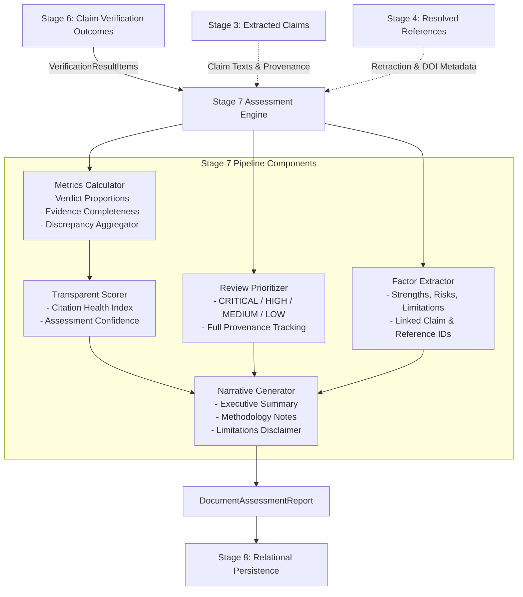

# Stage 7 — Document-Level Assessment Engine

## 1. Overview & Objective

Stage 7 (Assessment) aggregates manuscript-level scientific claim verification outcomes from Stage 6 into a transparent, explainable citation health assessment. Rather than generating an opaque pseudo-probability score, the engine computes statistical verdict distributions, tracks evidence completeness, identifies methodological or numerical discrepancies, and compiles a prioritized human-in-the-loop review queue.



---

## 2. Input and Output Contracts

### Input Contract (`S7AssessmentInput`)

```python
class S7AssessmentInput(BaseModel):
    document_id: str
    results: List[Any] = Field(default_factory=list)  # List of VerificationResultItem or dicts
    claims: Optional[List[Dict[str, Any]]] = None
    resolved_references: Optional[List[Dict[str, Any]]] = None
    metadata: Optional[Dict[str, Any]] = None
```

### Output Contract (`S7AssessmentOutput`)

```python
class S7AssessmentOutput(BaseModel):
    document_id: str
    overall_health_score: float  # Heuristic Citation Health Index (0.0 to 100.0)
    summary: Dict[str, int]      # Verdict counts (backward compatible with pipeline orchestrator)
    assessment_notes: str        # Transparent diagnostic summary
    report: Optional[DocumentAssessmentReport] = None
    warnings: List[str] = Field(default_factory=list)
```

---

## 3. Core Principles & Ethical Verification Policies

1. **Transparent Administrative Index vs. Truth Probability**:
   The `overall_health_score` is a transparent heuristic Citation Health Index (0–100) intended exclusively for manuscript triage, editorial prioritization, and risk assessment. It is explicitly **not** a validated scientific probability of factual truth.
2. **Absence of Evidence is Not Evidence of Falsehood**:
   When cited source evidence cannot be retrieved from academic repositories (`unavailable`), CiteVerify records an `insufficient_evidence` determination. The system strictly avoids classifying unretrieved or paywalled citations as "contradictions" or "false claims".
3. **Contradiction Precedence**:
   Direct empirical contradictions and formal literature retractions take strict precedence over lexical overlap. A claim whose cited source reports opposing findings is never marked supported.
4. **Complete Traceability**:
   Every risk factor, priority item, and summary point maintains immutable links to corresponding `claim_id`s, `reference_id`s, `evidence_id`s, and passage provenance snippets.

---

## 4. Prioritization Matrix for Human Review

Claims evaluated by Stage 6 are prioritized into a human review queue according to scientific severity:

| Priority | Trigger Conditions | Rationale |
|---|---|---|
| **CRITICAL** | Formally retracted source (`is_retracted_source` / `retraction_warning`), or Empirical contradiction (`CONTRADICTORY`) | Severe integrity risk; manuscript relies on invalid or opposing literature. |
| **HIGH** | Unsupported claim (`UNSUPPORTED`), Numerical mismatch (`mismatch`), Severe context mismatch (`context_mismatch`), Outdated citation (`POTENTIALLY_OUTDATED`) | Methodological divergence; values or claims are unsubstantiated or conflicting. |
| **MEDIUM** | Partial support (`PARTIALLY_SUPPORTED`), Hedging/overgeneralization, Low verification strength ($< 0.6$), Abstract-only limitation | Minor scope discrepancy or incomplete textual coverage. |
| **LOW** | Insufficient evidence due to unavailable source (`INSUFFICIENT_EVIDENCE`) | Administrative flag for source acquisition; distinguished from empirical falsehood. |

---

## 5. Scoring Formulation

### A. Base Fidelity
$$\text{Base Fidelity} = \frac{N_{\text{supported}} \times 1.0 + N_{\text{partially\_supported}} \times 0.5}{N_{\text{total\_claims}}} \times 100.0$$

### B. Evidence Coverage Weighting
$$\text{Coverage Factor} = P_{\text{full\_text}} \times 1.0 + P_{\text{abstract\_only}} \times 0.8 + P_{\text{unavailable}} \times 0.0$$
$$\text{Raw Score} = \text{Base Fidelity} \times (0.7 + 0.3 \times \text{Coverage Factor})$$

### C. Deductions for Verified Discrepancies
- **Retracted Sources**: $-30.0$ points per unique retracted source cited (capped at $-60.0$).
- **Contradictions**: $-20.0$ points per contradicted claim.
- **Numerical Mismatches**: $-10.0$ points per numerical divergence.
- **Scope Mismatches**: $-5.0$ points per context extrapolation.

$$\text{Final Index} = \max\left(0.0, \min\left(100.0, \text{Raw Score} - \text{Deductions}\right)\right)$$

---

## 6. Categorical Document Classifications

- `ROBUST_SUPPORT`: Verified support rate $\ge 75\%$, full-text coverage $\ge 50\%$, 0 critical concerns, 0 retractions.
- `MODERATE_CONCERNS`: Minor scope shifts, 1 numerical mismatch, or moderate partially supported rate ($> 15\%$).
- `HIGH_CONCERNS`: Unsupported rate $> 20\%$, outdated citations, or $\ge 2$ numerical mismatches.
- `CRITICAL_CONCERNS`: Any cited reference is retracted, or any claim is empirically contradicted.
- `INSUFFICIENT_EVIDENCE`: $\ge 50\%$ of claims lack retrieved evidence.
- `UNASSESSED_EMPTY`: Zero claims provided or evaluated.
